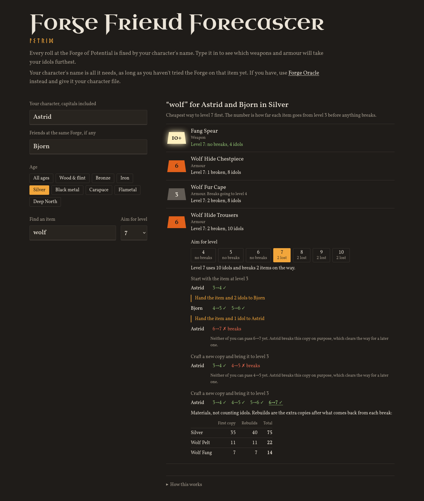

# Forge Friend Forecaster

See which Valheim weapons and armour will survive the Forge of Potential before you spend an idol, and plan who in your group should press the button at each step.

Forge of Potential rolls are fixed in advance. Each item type and level step has its own roll, and the first one comes from your character's name, so any item you haven't tried at the Forge yet can be worked out from the name alone, with no save file. For an item you have tried, use [Forge Oracle](https://github.com/papptimus/Forge-Oracle) with your character file instead.

Unofficial fan tool. Not affiliated with or endorsed by Iron Gate AB. Builds on [Forge Oracle](https://github.com/papptimus/Forge-Oracle) by papptimus, which worked out the roll mechanics.

## Use it

Open `index.html` in a browser. Everything runs locally.
